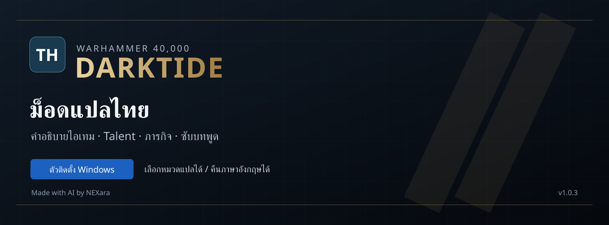
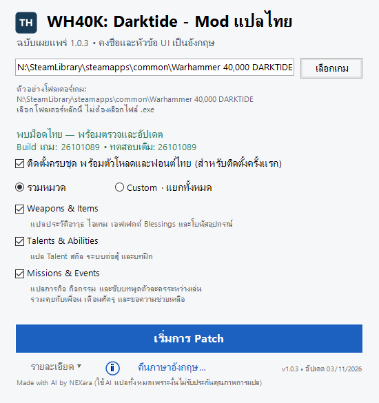
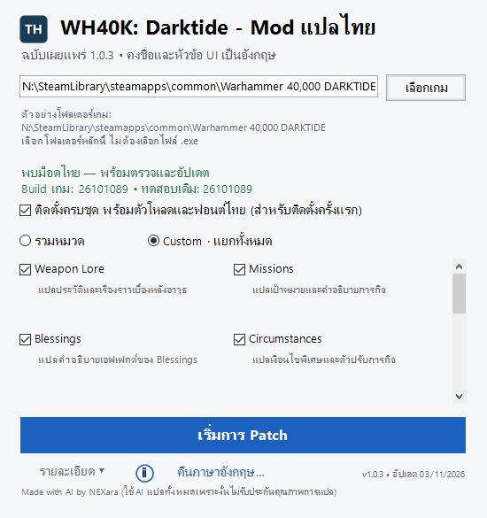
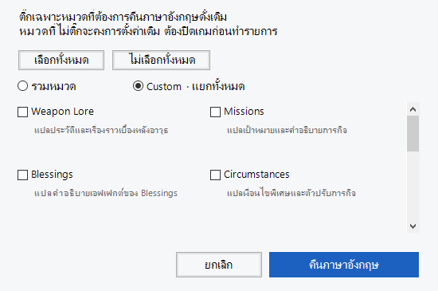

<p align="center"></p>

# WH40K: Darktide — ม็อดแปลไทย

**เวอร์ชันล่าสุด: 1.0.4 · อัปเดตล่าสุด: 4 พฤศจิกายน 2569 (04/11/2026)**

อ่านคำอธิบายไอเทม Talent ภารกิจ และซับบทพูดเป็นภาษาไทยได้ โดยยังเก็บชื่ออาวุธ ไอเทม ศัตรู และหัวข้อเมนูเป็นอังกฤษ จะได้หาเทียบกับไกด์หรือคุยกับเพื่อนได้ง่าย

**[ดาวน์โหลดชุดพร้อมติดตั้ง](https://github.com/NEXara/WH40K-Darktide-Thai/releases/latest)** · **[ดูคลิป Preview](https://www.youtube.com/watch?v=UfbwgEBtZoI)** · **[แจ้งคำแปลหรือปัญหา](https://github.com/NEXara/WH40K-Darktide-Thai/issues)**

> Made with AI by NEXara (ใช้ AI แปลทั้งหมดเพราะงั้นไม่รับประกันคุณภาพการแปล)
>
> แจกฟรี ไม่รับรายได้จากชุดนี้ หากเจอคำแปลแปลกๆ หรือข้อความที่ยังเป็นอังกฤษ ส่งภาพและบอกว่าพบตรงไหนได้เลย

## อัปเดต 1.0.4

- เพิ่มคำแปลใหม่ 381 Key รวมคติหน้าโหลด 310 รายการ คงวลี Imperialis Dominatus เป็นอังกฤษ
- เก็บตกคำอธิบาย Penance หลายคลาสและเงื่อนไขภารกิจ Ransacked Routes
- ใน Custom เลือก **Story Events & Loading** เพื่อแปลเนื้อเรื่อง กิจกรรม คติหน้าโหลด และข้อความช่วยเหลือ หมวดนี้อยู่ใน **Missions & Events** เมื่อใช้โหมดรวม
- แก้เป้าหมายภารกิจจากเปิดสะพานเป็นปิดสะพานตามข้อความเกม

## ดูตัวอย่างในเกม

[](https://www.youtube.com/watch?v=UfbwgEBtZoI)

คลิป Preview Gameplay ที่ NEXara บันทึกไว้ กดที่ภาพเพื่อดูบน YouTube

## ติดตั้งครั้งแรก

1. ไปที่หน้า **[Releases](https://github.com/NEXara/WH40K-Darktide-Thai/releases/latest)** แล้วดาวน์โหลดไฟล์ **WH40K-Darktide-Thai-1.0.4.zip** ในส่วน Assets — ไม่ใช่ Source code (zip)
2. แตก ZIP **ทั้งชุด** ลงโฟลเดอร์ใหม่ อย่าเปิดโปรแกรมจากใน ZIP และอย่าแยกไฟล์ `.exe` ออกจากโฟลเดอร์ `package`
3. ปิดเกม แล้วเปิด **WH40K-Darktide-Thai-Mod.exe**
4. กด **เลือกเกม** และเลือกโฟลเดอร์หลักของ Darktide เช่น

   ```text
   N:\SteamLibrary\steamapps\common\Warhammer 40,000 DARKTIDE
   ```

   หากเกมอยู่ไดรฟ์อื่น ให้เลือกตำแหน่งของคุณเอง ใน Steam ใช้ Manage → Browse local files เพื่อหาได้ เลือกโฟลเดอร์หลัก ไม่ต้องเลือกไฟล์ `.exe`

5. ติ๊ก **ติดตั้งครบชุด พร้อมตัวโหลดและฟอนต์ไทย (สำหรับติดตั้งครั้งแรก)**
6. เลือกหมวดที่อยากแปล แล้วกด **เริ่มการ Patch** รอหน้าต่างแจ้งผล
7. เปิดเกมโดยใช้ภาษา **English** และเปิด **Subtitles** หากต้องการอ่านซับบทพูดไทย

ชุดพร้อมติดตั้งรวมส่วนประกอบที่จำเป็นและฟอนต์ไทยแล้ว ไม่ต้องดาวน์โหลดม็อดแต่ละตัวเพิ่มสำหรับการติดตั้งชุดนี้ อ่านรายชื่อและลิงก์ต้นทางใน [เครดิต](CREDITS.md)

### หน้าตาโปรแกรม

<p align="center"></p>

## เลือกแปลส่วนไหนได้บ้าง

โหมด **รวมหมวด** เลือกได้ 3 กลุ่ม:

| หมวด | แปลอะไร |
|---|---|
| Weapons & Items | ประวัติอาวุธ เรื่องราวไอเทม คำอธิบาย Blessings และโบนัสอุปกรณ์ |
| Talents & Abilities | คำอธิบาย Talent สกิล กลไกการต่อสู้และบทฝึก |
| Missions & Events | ภารกิจ เงื่อนไขพิเศษ ความสำเร็จ เนื้อเรื่อง และ **ซับบทพูดระหว่างเล่น** เช่น คุยกับเพื่อน เตือนศัตรู หรือขอความช่วยเหลือ |

ถ้าอยากเลือกละเอียด ใช้ **Custom** แยกได้ 11 หมวด: Weapon Lore, Blessings, Item Lore, Item / Weapon Descriptions, Talents, Abilities, Missions, Circumstances, Achievements, Story Events & Loading และ Subtitles

<p align="center"></p>

**สิ่งที่ตั้งใจเก็บเป็นอังกฤษ:** ชื่ออาวุธ ไอเทม บุคคล ศัตรู หัวข้อและปุ่ม UI รวมถึงศัพท์ เช่น Stack, Cooldown, Buff การเห็นคำเหล่านี้เป็นอังกฤษจึงไม่ใช่อาการแปลไม่ติด

## อยากคืนซับหรือบางหมวดเป็นอังกฤษ

ปิดเกม เลือกโฟลเดอร์เกม แล้วกด **คืนภาษาอังกฤษ…** เลือกหมวดที่ต้องการใน Custom เช่น **Subtitles** แล้วกด **คืนภาษาอังกฤษ** จากนั้นเปิดเกมใหม่ หมวดที่ไม่ได้เลือกจะคงการตั้งค่าเดิม ถ้าต้องการคืนทุกหมวดให้กด **เลือกทั้งหมด**

<p align="center"></p>

โหมดนี้ปิดคำแปลของม็อดนี้เฉพาะหมวดที่เลือก ไม่ได้ลบฟอนต์หรือตัวโหลด หากมีม็อดแปลภาษาอื่นเปิดอยู่ ม็อดนั้นยังอาจเปลี่ยนข้อความได้

อยากกลับมาใช้ไทยอีกครั้ง ให้ติ๊กหมวดบนหน้าหลักแล้วกด **เริ่มการ Patch**

## อัปเดตม็อดหรือหลังเกมอัปเดต

- **อัปเดตคำแปล:** แตกชุดใหม่ลงโฟลเดอร์ใหม่ ปิดเกม เลือกโฟลเดอร์เกมและหมวด แล้ว Patch อีกครั้ง ถ้ามีส่วนประกอบครบแล้วไม่ต้องติ๊กติดตั้งครบชุด
- **เกมอัปเดตแล้วม็อดไม่ทำงาน:** ปิดเกมแล้ว Patch ใหม่ ตัวติดตั้งจะตรวจความเข้ากันได้ก่อน
- **เจอ build ที่ยังไม่เคยทดสอบ:** โปรแกรมตรวจไฟล์และลองกับสำเนาฐานข้อมูลก่อน แล้วถามให้เลือก Yes / No ปุ่มเริ่มต้นคือ No ถ้าโครงสร้างไม่รองรับจะหยุด
- **เจอส่วนประกอบม็อดเดิมคนละรุ่น:** โปรแกรมจะหยุดแจ้งข้อขัดแย้ง ไม่เขียนทับม็อดนั้นเงียบๆ ดูรายละเอียดในช่องข้อความ

ตัวติดตั้งไม่มี Backup ถาวร Steam ซ่อมไฟล์เกมได้ แต่ไม่กู้คำแปลหรือม็อดที่คุณแก้เอง ควรเก็บงานที่แก้เองแยกไว้

## ถ้าติดตั้งแล้วไม่ขึ้นไทย

- ตั้งภาษาเกมเป็น **English** และตรวจว่าติ๊กหมวดที่ต้องการแล้ว
- หากเป็นซับบทพูด ให้เปิด Subtitles ในเกมและเปิดหมวด Subtitles ในตัวติดตั้ง
- อ่านช่อง **รายละเอียด** และข้อความในหน้าต่าง Patch สำเร็จ / Patch ล้มเหลว
- หากเห็นอักษรเป็นสี่เหลี่ยมหรือเกมมีข้อความใหม่ ให้แนบภาพหน้าเกม ตำแหน่งที่พบ และเลข build ตอนแจ้งปัญหา ไม่ต้องส่งรหัสผ่านหรือไฟล์ส่วนตัว
- ม็อดแปลอื่นหรือม็อดที่เปลี่ยนฟอนต์อาจมีผลร่วมกัน ควรระบุรายชื่อม็อดที่ใช้ด้วย

## รุ่นนี้ครอบคลุมแค่ไหน

**เวอร์ชัน 1.0.4** มีรายการคำแปลและปรับข้อความ **140,567 Key** เทียบกับข้อความที่ดึงจากเกมได้ 152,069 Key รายการที่คงอังกฤษรวมชื่อเฉพาะ หัวข้อ UI รหัส และเสียงร้อง การดึงอาศัยรายการ Key ที่รู้จักและพบระหว่างเล่น จึงไม่ใช่คำยืนยันว่าค้นพบข้อความครบทุกจุดในเกม

build เกมบนเครื่องที่ตรวจล่าสุดคือ **26101089** เมื่อ **4 พฤศจิกายน 2569** รุ่นที่เคยยืนยันใช้งานคือ 25681127 และ 26101089 เลข build ในโปรแกรมมาจาก Steam manifest ของเครื่องที่เลือก ไม่ได้อ้างว่าเป็น build ล่าสุดของทุกคน

ระบบติดตั้งและคืนภาษาอังกฤษผ่านการทดสอบจำลอง 85 กรณีในรุ่น 1.0.4 พร้อมตรวจ Lua ทั้ง 4 แบบและการเลือกหมวด ยังไม่ได้ทดสอบการแสดงผลจริงในเกมของรุ่นนี้ ฟอนต์และการแสดงผลอาจต่างกันตามเกมและม็อดที่ติดตั้ง จึงควรลองในเครื่องของคุณ

ม็อดนี้เปลี่ยนข้อความและฟอนต์ ไม่ได้ปลดล็อก DLC ผู้ที่ไม่มี DLC ยังเข้าถึงได้เฉพาะเนื้อหาที่เกมอนุญาตตามปกติ

## เครดิตและไฟล์ต้นทาง

ขอบคุณ **deluxghost**, ทีม **Darktide Mod Framework**, **ManShanko**, **Aussiemon** และโครงการฟอนต์ **Noto** รวมถึงผู้ร่วมพัฒนาทุกคน ดู [CREDITS.md](CREDITS.md) และ [THIRD_PARTY_NOTICES.md](THIRD_PARTY_NOTICES.md) สำหรับหน้าม็อดต้นฉบับและใบอนุญาต

แนวทางเผยแพร่ตามที่ deluxghost แนะนำคือ: **ตัวติดตั้งครบชุดอยู่บน GitHub** ส่วน [ชุด Nexus](https://www.nexusmods.com/warhammer40kdarktide/mods/1588) แยกเฉพาะม็อดแปลไทยและกำหนด dependencies ไปยังหน้าต้นฉบับ ไม่อัป repack dependencies บน Nexus

ผู้พัฒนาที่ต้องการดึง artifacts จากต้นทาง ดู [แนวทางเตรียมส่วนประกอบ](docs/DEPENDENCIES.md) รุ่นที่แจกจะระบุไฟล์และ hash ที่ใช้จริง ไม่สลับส่วนประกอบในเครื่องผู้เล่นเป็นรุ่นใหม่อัตโนมัติ

ตัวติดตั้งและซอร์สอยู่ใน ZIP ที่หน้า Releases ซอร์สตัวติดตั้งอ่านได้ใน [source](source) ไม่มีไฟล์เกมต้นฉบับ `Darktide.exe` หรือ `bundle_database.data` รวมอยู่ด้วย

โปรเจกต์แฟนเมดนี้ไม่ได้เป็นผลิตภัณฑ์ทางการของ Fatshark หรือ Games Workshop ชื่อเกม เครื่องหมายการค้าและเนื้อหาเกมยังเป็นของเจ้าของเดิม ภาพหน้าต่างโปรแกรมเป็นการเรนเดอร์จากตัวติดตั้งจริง ภาพตัวอย่างเกมอยู่ในคลิปของผู้จัดทำ ไม่ได้ใช้ภาพทดสอบฟอนต์เก่ามาอ้างว่าเป็นรุ่นปัจจุบัน
